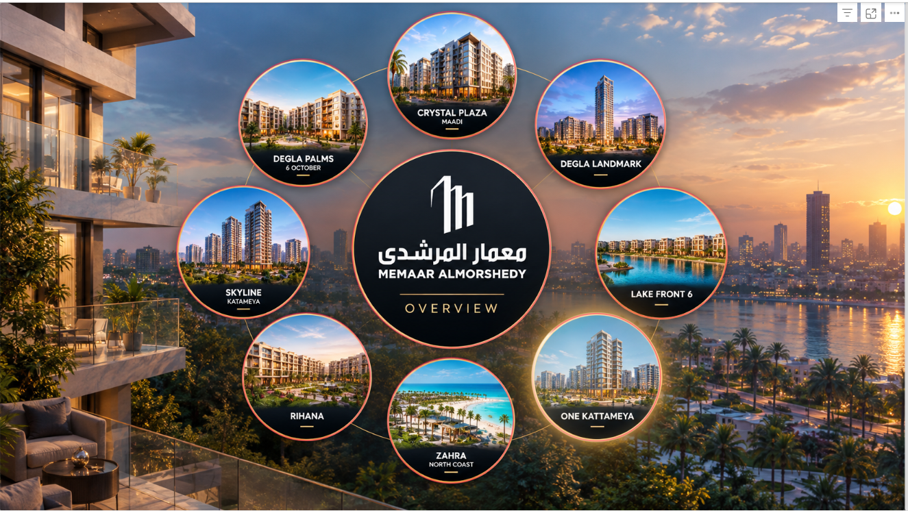

# Maamar Al Morshedy | Real Estate Data Analysis

## Project Overview

An interactive Power BI report analyzing collection and payment data across **eight real estate projects** associated with Maamar Al Morshedy. The report brings the projects together in one report, with shared overview pages and dedicated analysis pages for each project.

A major part of the work involved **data cleaning and transformation using Power Query**, preparing the source data for analysis and reporting.

## Project Objectives

- Clean and prepare the source data for analysis.
- Consolidate eight real estate projects into one Power BI report.
- Present an overall view of the projects and collection performance.
- Explore project-level collection through different payment types.
- Support clearer review of the available data through interactive Power BI visuals.

## Tools & Technologies

- **Power BI** — report development and interactive data visualization.
- **Power Query** — data cleaning and transformation.

## Data Preparation

The source data required substantial cleaning before it could be used in the report. Power Query was used to clean and transform the data as part of the preparation process.

## Report Structure

The report contains **35 pages**: three general pages and four pages for each of the eight projects.

### General Pages

- Home
- Global Summary
- Collection

### Projects Covered

1. One Kattameya
2. Zahra
3. Crystal Plaza
4. Degla Landmark
5. Skyline Kattameya
6. Degla Palms
7. Lake Front
8. Rihana

Each project has dedicated pages for:

- **Overall**
- **Bank**
- **Cash**
- **Bank - Wise**

## Dashboard Preview

The screenshots below are **selected samples** from the full report. They showcase the general overview pages and several detailed views for One Kattameya. They are not a complete representation of all report pages; the full report covers all eight real estate projects listed above.

### General Overview

### One Kattameya — Detailed Analysis

## Interactive Report

The Power BI report file is included in this repository. If a published interactive report link becomes available, it can be added here.

## Project Files

- `Graduation Project.pbix` — Power BI report file.
- `images/` — selected dashboard screenshots.
- `README.md` — project documentation.

## Disclaimer

This project is presented for portfolio and learning purposes. The analysis should be interpreted in the context of the source data and its limitations.
